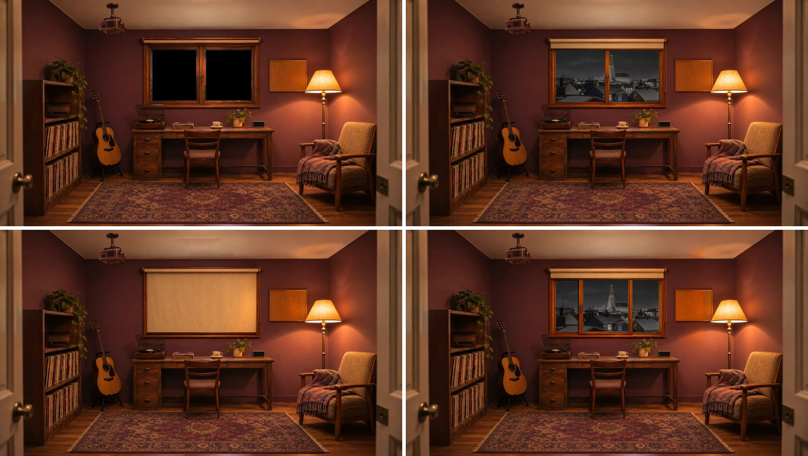
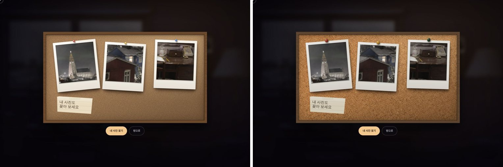
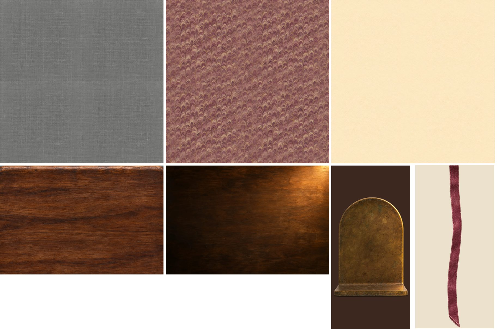
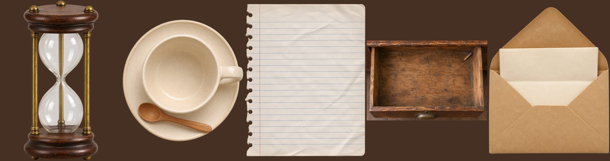

# FEEDBACK · Batch 1 (2026-11-13, Claude)

**Result: all 5 accepted. No redo needed.** Thank you for flagging the issues honestly.

| Item | Verdict | Note |
|---|---|---|
| R1 | Accepted | Pixel-perfect alignment with the reference (0 px shift). Green is near-pure (mean RGB 4/250/6), which keys cleanly. |
| R2 | Accepted | Blind sits inside the frame as asked. |
| R3 | Accepted | Sliding structure reads correctly at room scale. |
| B2 | Accepted | 1254 px is fine; Claude downscaled to 1024 and repaired the seams (edge difference now equals inner difference). |
| B3 | Accepted | 1254 px and real alpha. Claude split it into four pins. |

## Rule clarification for the next batches

- A square output of 1254×1254 instead of 1024×1024 is fine. Do not resize; just report it.
- Near-#00FF00 green is fine.
- For seamless textures, aim for wrapping edges; a near miss is fine.

## Next

Batch 2 (K1, K2, K3, V1, V2, V3, V4) when the user says go. No changes to the prompts.

---

# FEEDBACK · Batch 2 (2026-11-13, Claude)

**Result: all 7 accepted. No redo needed.**

| Item | Verdict | Note |
|---|---|---|
| K1 | Accepted | Downscaled, blotches flattened, seams repaired. |
| K2 | Accepted | Used as is. |
| K3 | Accepted | Real alpha, clean edge. |
| V1 | Accepted | Seams repaired. |
| V2 | Accepted | Nearly seamless already. |
| V3 | Accepted | Used as is. |
| V4 | Accepted | Claude removed the semi-transparent halo around the ribbon. Next time a hard-edged alpha (no glow) is preferred. |

## Next

Batch 3 (P1–P5) when the user says go. For P1–P5 please keep alpha edges hard (no glow/halo).

---

# FEEDBACK · Batch 3 (2026-11-13, Claude)

**Result: all 5 accepted. All 17 items are done. Thank you.**

P1 halo removed, P2/P3/P5 edges cleaned and cropped; the size differences did not matter. Nothing more is needed unless the user asks for additions.

---

# FEEDBACK · Batch 4 (2026-11-14, Claude)

**Result: S1–S3 accepted and live on the site.** Pixel-perfect alignment. S2 came out bluer than the reference; Claude color-matched it. Batch 5 (W1–W6) is next.
