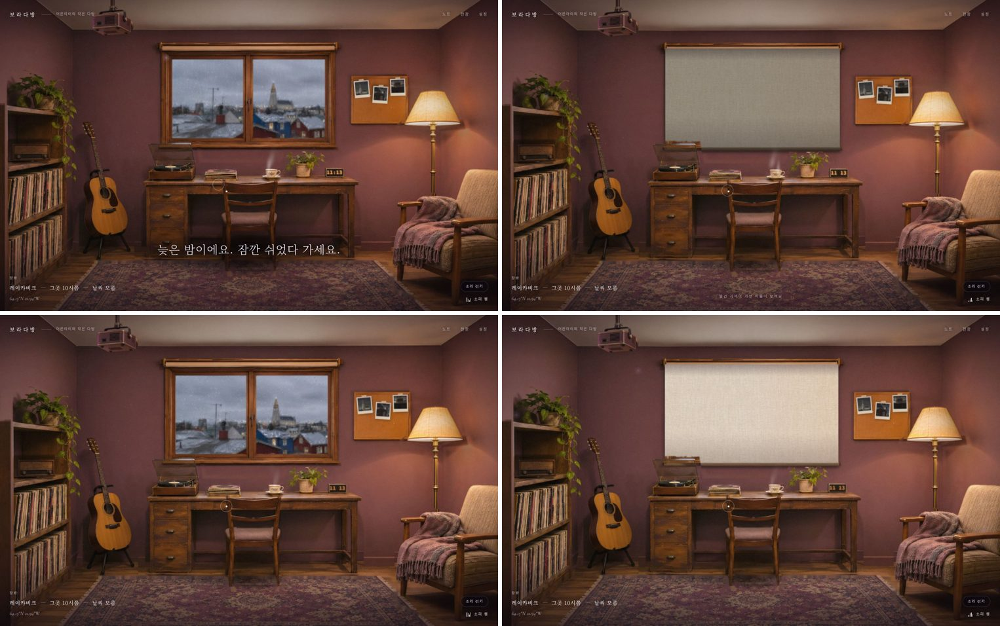
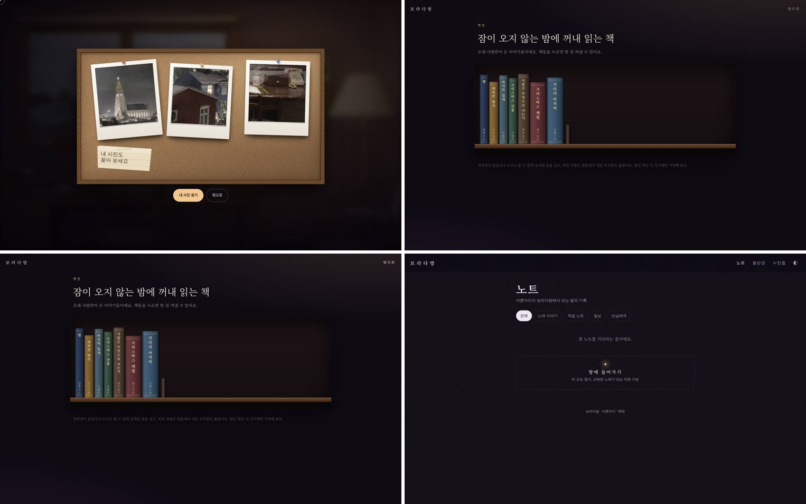
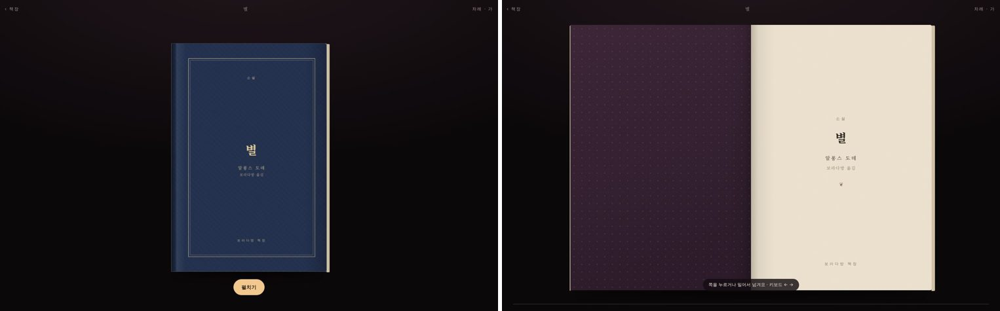

# 보라다방 디자인 점검과 이미지 주문 목록

2026-11-13 · 기준: 운영 홈페이지 `bora_hp@2546e6d`

> 이 브랜치(`img-lab`)는 임시 공간입니다. **매일 새벽 4시 13분(한국 시간)에 올린 이미지와 지난 기록이 지워지고** 주문서만 남습니다. 올려 주신 이미지는 그날 안에 Claude가 처리합니다.

## 한눈에

- 필요한 그림은 **17장**, 세 차례로 나눴습니다. **1차 5장만 먼저** 하면 가장 눈에 띄는 곳(닫힌 창, 사진첩)이 바뀝니다.
- **17장 모두 업스케일링이 필요 없습니다.** 방 그림은 창 부분만 잘라 보내 고치는 방식으로 바꿔서, GPT가 한 번에 그리는 크기(1536 × 1024) 안에 들어옵니다.
- 그림 없이 제가 코드로 고칠 것도 7가지 있습니다(맨 아래).

## 점검 결과: 어디가 약한가



**1. 닫힌 창 (가장 급함)**
- 블라인드를 내리면 **민무늬 베이지 사각형이 창 위에 붙은 것처럼** 보입니다. 창틀까지 덮어서 창이 사라지고, 천에 주름도 그림자도 없습니다.
- 스탠드 불빛이 오른쪽에서 오는데 블라인드는 고르게 밝아서 방의 빛과 따로 놉니다.
- 줄이 없어서 걷혀 있을 때는 블라인드인지 막대인지 알기 어렵습니다.
- 왼쪽 아래 모서리가 턴테이블 뚜껑과 어색하게 겹칩니다.
- 창이 열린 모습의 그림이 없습니다(지금은 닫힌 창 그대로 소리만 바뀝니다).



**2. 사진첩(코르크보드)**: 코르크와 압정을 화면에서 그린 것이라 평평합니다. 방의 실사 느낌과 차이가 납니다.

**3. 책장**: 책등이 민무늬 색띠입니다. 천 질감, 닳은 모서리가 없고 선반도 평평한 갈색 띠입니다. 책이 일곱 권이라 오른쪽 절반이 비어 있습니다.



**4. 책 뷰어**: 표지, 면지(보라색 점무늬), 종이가 모두 단색입니다. 책이 검은 허공에 떠 있어 "책상 위에 놓인 책" 느낌이 없습니다.

**5. 작은 기능 화면들**(차 우리기, 걱정 맡기기, 쪽지): 글자와 단추만 있고 소품이 없습니다.

---

## 진행 방법

**프롬프트를 하나씩 옮기지 않아도 됩니다.** ChatGPT에 아래 한 줄만 보내면 GPT가 이 공간의 안내문(`FOR_GPT.md`)과 주문서를 직접 읽고 차례대로 만듭니다.

```
이 문서를 읽고 그대로 진행해 줘: https://github.com/ysangyn/bora_hp/blob/img-lab/FOR_GPT.md
```

1. GPT가 1차 5장을 만들고 멈춥니다. 창 사진을 스스로 불러오지 못하면 `ref_window_on.png`를 한 번 첨부해 달라고 할 수 있습니다.
2. 받은 파일을 한꺼번에 이 브랜치 `inbox/` 폴더에 올립니다(여러 장을 한 번에 끌어다 놓을 수 있습니다). 캡처 말고 다운로드한 원본으로.
3. Claude에게 "올렸어"라고 알려 주세요. 맞춰 넣은 화면을 보여 드리고, 고칠 점은 `FEEDBACK.md`에 적어 둡니다. GPT에는 "FEEDBACK.md 보고 다시 해 줘"라고만 하면 됩니다.
4. 2차, 3차는 GPT에 "다음 차례 진행해 줘"라고 하면 됩니다.

매일 새벽에는 `inbox/`에 올린 이미지와 지난 기록만 지워지고, 주문서와 안내문은 남습니다.

---

# 1차 · 5장 (닫힌 창, 사진첩)

방 그림 3장은 **창 부분만 잘라 낸 사진을 고쳐 달라는 방식**입니다. 새로 그리면 방과 어긋나므로 반드시 첨부 사진을 올리고 "편집"으로 부탁합니다.

## R1 · 블라인드에 줄 달기 (걷힌 상태)

- 쓰이는 곳: 평소의 창. 블라인드가 블라인드로 보이게.
- 첨부: `ref_window_on.png` · 받을 크기: 1536 × 1024

```
Edit the attached image. Keep the camera, framing, wall, window frame, lighting, colors and film grain exactly the same. Do not crop or resize.
Change only the roller blind at the top of the window: make it clearly read as a fabric roller blind. Let about 8 cm of oatmeal linen fabric hang below the roll, ending in a slim dark walnut bottom rail. Add a realistic beaded pull chain (small antique-brass ball chain loop) hanging along the RIGHT side of the window frame down to about two thirds of the window height, casting a very soft shadow on the wall and catching the warm lamp light from the right.
Fill the entire glass area of both window panes with flat pure green #00FF00.
Photorealistic. Add nothing else.
```

## R2 · 블라인드를 다 내린 모습

- 쓰이는 곳: 창을 가릴 때, 프로젝터로 영상을 볼 때.
- 첨부: `ref_window_on.png`와 **R1 결과물** · 받을 크기: 1536 × 1024

```
Edit the first attached image so it matches the second one in every detail (same blind fabric, same chain, same light), but with the roller blind pulled fully down.
The oatmeal linen fabric hangs INSIDE the window frame, covering the glass down to the sill; the wooden window frame stays fully visible around it. The dark walnut bottom rail rests just above the sill. The beaded chain still hangs on the right.
Fabric: slightly translucent linen, faint vertical weave, very slight soft waviness, a gentle shadow from the frame along the top and left edges, and warmer, brighter light on the right side where the lamp is.
Keep camera, framing, wall, colors and film grain exactly the same. Do not crop or resize. Photorealistic. Add nothing else.
```

## R3 · 창문이 열린 모습

- 쓰이는 곳: "창 열기"를 눌렀을 때.
- 첨부: **R1 결과물** · 받을 크기: 1536 × 1024

```
Edit the attached image. Keep everything exactly the same. Change only the window: slide the RIGHT sash open to the left so that it overlaps the left sash by about half, like a real horizontal sliding wooden window. Keep the frame thickness, the latch and the perspective realistic.
The opened gap must be flat pure green #00FF00, and all remaining glass must also be flat pure green #00FF00.
Same lighting and film grain. Do not crop or resize. Photorealistic.
```

> 밤에 불 끈 방과 낮의 방은 우선 제가 이 세 장의 색을 바꿔서 만들어 봅니다. 어색하면 그때 `ref_window_day.png`, `ref_window_off.png`로 같은 주문을 한 번 더 부탁드리겠습니다.

## B2 · 코르크 질감 (이어 붙이는 무늬)

- 쓰이는 곳: 사진첩을 열었을 때의 코르크 판 바탕.
- 첨부: 없음 · 받을 크기: 1024 × 1024

```
Seamless tileable texture, 1024x1024: close-up of a natural cork board surface seen perfectly straight-on.
Warm honey-brown cork granules of irregular sizes, a few slightly darker grains and tiny pores, fine and realistic, real-world scale as if the full image covers about 25 cm.
Completely even, shadowless lighting so the tile repeats without visible seams; left/right and top/bottom edges must wrap seamlessly.
No pins, no paper, no frame, no vignette, no text.
```

## B3 · 압정 4개 (투명 배경)

- 쓰이는 곳: 코르크 판에 사진을 꽂는 압정.
- 첨부: 없음 · 받을 크기: 1024 × 1024, 배경 투명 PNG

```
Four vintage round-head push pins on a fully transparent background, PNG, 1024x1024, arranged in a 2x2 grid with generous empty space between them.
Colors: faded tomato red, mustard yellow, cream, deep forest green. Matte, slightly worn enamel heads, short steel needle mostly hidden.
Viewed from about 60 degrees above, soft warm light from the upper left, each pin casting a small soft shadow.
Photorealistic, no background, no surface, no text.
```

---

# 2차 · 7장 (책장, 책 뷰어)

## K1 · 책 천 질감 (회색, 이어 붙이는 무늬)

- 쓰이는 곳: 책등과 책 표지. **회색 한 장만 받으면** 제가 책마다 남색·겨자색·초록 등으로 물들입니다.
- 받을 크기: 1024 × 1024

```
Seamless tileable texture, 1024x1024: old bookbinding cloth (buckram / linen book cloth) seen straight-on, in neutral mid-gray.
Fine woven grain, slightly uneven, a few faint rubbed and worn patches, very subtle. Even shadowless lighting, edges wrap seamlessly.
No text, no gold stamping, no stains that would show when tiled.
```

## K2 · 책장 나무

- 쓰이는 곳: 선반 앞면과 책장 뒷판. 한 장에서 잘라 씁니다.
- 받을 크기: 1536 × 1024

```
Straight-on close-up of an old dark walnut wood board, 1536x1024, grain running horizontally.
Warm brown, satin worn finish, fine grain with a few darker streaks and tiny dents, slightly rounded worn top edge visible along the top 10% of the image.
Even soft light, no strong shadows, no objects, no text.
```

## K3 · 놋쇠 북엔드 (투명 배경)

- 쓰이는 곳: 책 옆에 세워 빈 칸을 덜 허전하게.
- 받을 크기: 1024 × 1024, 배경 투명 PNG

```
A single small antique brass L-shaped bookend on a fully transparent background, PNG, 1024x1024, seen straight-on from the front at shelf height.
Aged brass with soft patina, simple arched top, no figures, no text. Warm low light from the right, soft shadow only at its base.
Photorealistic.
```

## V1 · 면지 무늬 (이어 붙이는 무늬)

- 쓰이는 곳: 책을 펼쳤을 때 왼쪽 안쪽 면. 지금은 보라색 점무늬.
- 받을 크기: 1024 × 1024

```
Seamless tileable texture, 1024x1024: traditional hand-marbled endpaper for an old book, seen straight-on.
Muted palette: deep plum, dusty mauve, cream, and thin veins of old gold. Small combed feather pattern, slightly faded, matte paper.
Even shadowless lighting, edges wrap seamlessly. No text.
```

## V2 · 본문 종이 (이어 붙이는 무늬)

- 쓰이는 곳: 책장을 넘기는 종이.
- 받을 크기: 1024 × 1024

```
Seamless tileable texture, 1024x1024: old uncoated cream book paper seen straight-on.
Warm ivory, very fine fibers and extremely subtle mottling, almost uniform so that text stays easy to read on top of it.
No stains, no foxing spots, no creases, no text. Even shadowless lighting, edges wrap seamlessly.
```

## V3 · 책이 놓인 책상 (위에서 본 모습)

- 쓰이는 곳: 책 뷰어의 바탕. 어둡게 깔아서 "책상 위의 책"으로 보이게. 흐리게 쓰는 그림이라 큰 화면에 늘려도 티가 나지 않습니다.
- 받을 크기: 1536 × 1024

```
Top-down view of an old dark walnut desk surface at night, 1536x1024.
Warm pool of lamp light falling from the upper right and fading to deep shadow toward the lower left. Worn wood grain, a few faint ring marks.
The center 70% of the image must stay empty wood. No objects, no text.
Photorealistic, soft, slightly low contrast.
```

## V4 · 가름끈 (투명 배경)

- 쓰이는 곳: 읽던 자리를 표시하는 끈.
- 받을 크기: 1024 × 1536, 배경 투명 PNG

```
A single narrow woven silk ribbon bookmark hanging straight down, on a fully transparent background, PNG, 1024x1536.
Faded burgundy, about 6 mm wide, slightly frayed diagonal-cut end at the bottom, a gentle natural curve. Soft warm light, no shadow.
Photorealistic, no text.
```

---

# 3차 · 5장 (기능 화면의 소품)

공통으로 끝에 붙이는 문장:

```
Single object, centered, soft warm even light, very soft shadow, on a fully transparent background, PNG, photorealistic, no text.
```

| 번호 | 쓰이는 곳 | 프롬프트 앞부분 | 받을 크기 |
|---|---|---|---|
| P1 | 차 우리기 | `A small antique hourglass with turned dark wood ends and three brass rods, clear EMPTY glass bulbs with no sand, standing upright, straight-on.` | 1024 × 1536 |
| P2 | 차 한 잔 | `A cream stoneware teacup on a matching saucer seen from directly above, empty, with a small wooden teaspoon on the saucer.` | 1024 × 1024 |
| P3 | 걱정 맡기기 | `A single page torn out of a ruled notebook, slightly creased, torn left edge, blank, seen from directly above.` | 1024 × 1536 |
| P4 | 걱정 맡기기 | `Inside of an open old wooden desk drawer seen from directly above, empty, worn wood, a pencil stub in one corner.` (이 장만 투명 배경 아님) | 1536 × 1024 |
| P5 | 오늘 밤의 쪽지 | `A small kraft paper envelope with the flap open and a folded cream letter paper half pulled out, blank, seen from directly above.` | 1536 × 1024 |

모래, 찻물, 글씨는 화면에서 그려 넣습니다. 그래서 꼭 **비어 있는 상태**로 받아야 합니다.

---

# 업스케일링이 필요한 것

이번 17장에는 없습니다. 아래는 나중에 하게 되면 도움이 필요한 것들입니다.

- 방 전체를 새로 그리는 일(해 질 녘의 방, 새벽의 방)
- 창밖 풍경을 새 도시로 추가하는 일

# 그림 없이 Claude가 코드로 고칠 것

1. 블라인드가 창틀 **안쪽**에서 내려오게(지금은 창틀을 덮음)
2. 블라인드와 턴테이블 뚜껑이 겹치는 순서 바로잡기
3. 불 끈 밤·낮에 블라인드 색이 방의 빛을 따라가게
4. 사진첩의 폴라로이드에 종이 두께와 그림자
5. 책등에 닳은 모서리, 금박 글씨의 빛 반사, 책마다 조금씩 다른 기울기
6. 책장의 빈 오른쪽 절반 정리(북엔드 뒤로 여백을 줄이거나 선반 폭을 책 수에 맞춤)
7. 책 뷰어에 책 아래 그림자와 책상 바탕

적용은 비공개 시험판에서 먼저 보여 드리고, 운영 홈페이지 반영은 승인받은 뒤에 합니다.

---

# 4차 · 3장 (방 안 책장: 아래 칸에 책)

방 왼쪽 책장의 **맨 아래 칸**이 지금은 레코드로 차 있어서, "책장"을 눌러도 책이 있는 곳으로 보이지 않습니다. 아래 칸만 오래된 책으로 바꿉니다. 책장은 비스듬히 보이는 각도라 반드시 첨부 사진을 **편집**해야 합니다.

| 번호 | 첨부 | 받을 크기 |
|---|---|---|
| S1 | `ref_shelf_on.png` (불 켠 밤) | 1024 × 1536 |
| S2 | `ref_shelf_off.png` (불 끈 밤) + S1 결과 | 1024 × 1536 |
| S3 | `ref_shelf_day.png` (낮) + S1 결과 | 1024 × 1536 |

## S1

```
Edit the attached image. Keep the camera angle, perspective, framing, black background, the bookcase wood, the plant, the upper record shelf, the lighting and film grain exactly the same. Do not crop, shift or resize.
Change only the BOTTOM shelf compartment (the lowest row, currently full of vinyl records): replace the records with old books standing upright, seen from the same oblique angle — a mix of faded cloth-bound hardcovers and a few paperbacks in muted burgundy, forest green, navy, mustard and cream, spines facing out, slightly uneven heights, two or three leaning, no readable titles or text.
The books must sit inside the shelf with correct perspective and receive the same warm, dim light as the rest of the bookcase.
```

## S2

```
Edit the first attached image so that its BOTTOM shelf compartment shows exactly the same books as the second attached image (same order, colors and leaning), but lit like the first image (lamp off, darker, cooler). Keep everything else in the first image exactly the same. Do not crop, shift or resize. No text.
```

## S3

```
Edit the first attached image so that its BOTTOM shelf compartment shows exactly the same books as the second attached image (same order, colors and leaning), but lit like the first image (soft daylight). Keep everything else in the first image exactly the same. Do not crop, shift or resize. No text.
```

---

# 5차 · 6장 (창문: 불 끈 밤과 낮)

1차에서 받은 창문 3장(R1 블라인드 줄, R2 다 내린 블라인드, R3 열린 창)은 **불 켠 밤**용입니다. 같은 창을 **불 끈 밤**과 **낮**으로도 받아야 방의 세 가지 빛에 다 맞출 수 있습니다. 모양은 1차 결과와 똑같이, 빛만 그 시간대 참고 사진을 따릅니다.

| 번호 | 첨부 1 (빛의 기준) | 첨부 2 (모양의 기준) | 받을 크기 |
|---|---|---|---|
| W1 | `ref_window_off.png` | `ref_R1_on.png` | 1536 × 1024 |
| W2 | `ref_window_off.png` | `ref_R2_on.png` | 1536 × 1024 |
| W3 | `ref_window_off.png` | `ref_R3_on.png` | 1536 × 1024 |
| W4 | `ref_window_day.png` | `ref_R1_on.png` | 1536 × 1024 |
| W5 | `ref_window_day.png` | `ref_R2_on.png` | 1536 × 1024 |
| W6 | `ref_window_day.png` | `ref_R3_on.png` | 1536 × 1024 |

## 여섯 장 모두 같은 글

```
Edit the FIRST attached image. Change only the window area so that the roller blind, the beaded chain, the bottom rail and the window sashes look exactly like in the SECOND attached image (same shape, position and state), but lit exactly like the FIRST image (same light direction, brightness, color temperature and shadows as the rest of the first image).
Keep the camera, framing, wall, ceiling, cork board and film grain of the first image exactly the same. Do not crop, shift or resize.
Wherever the second image shows flat pure green #00FF00 glass, keep that glass flat pure green #00FF00.
Photorealistic. Add nothing else.
```
